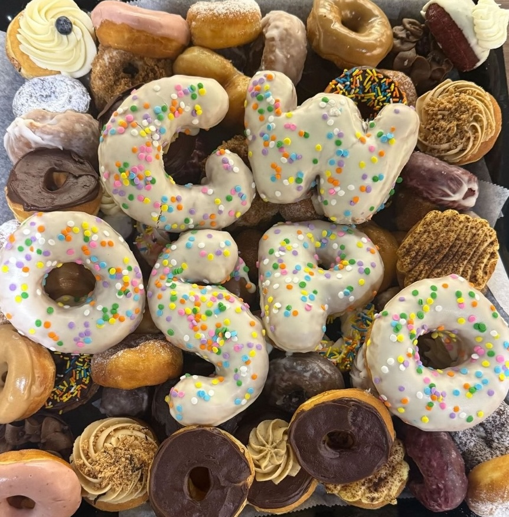
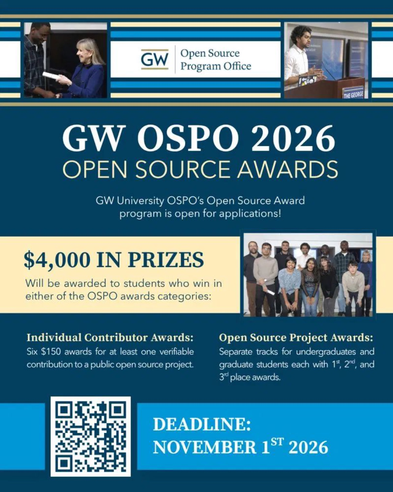
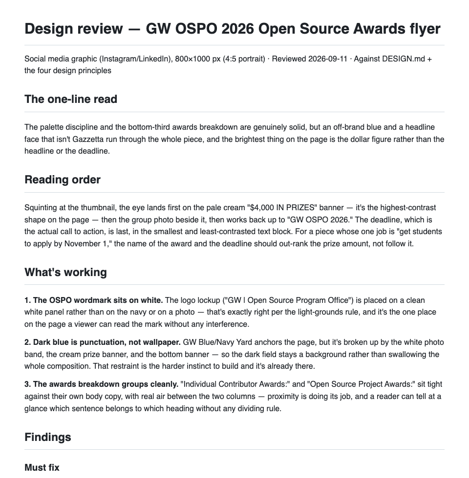
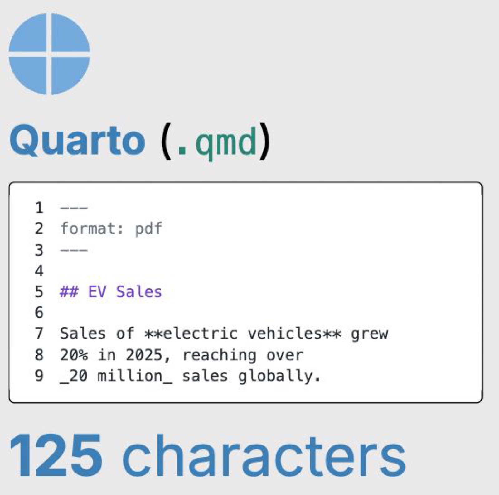
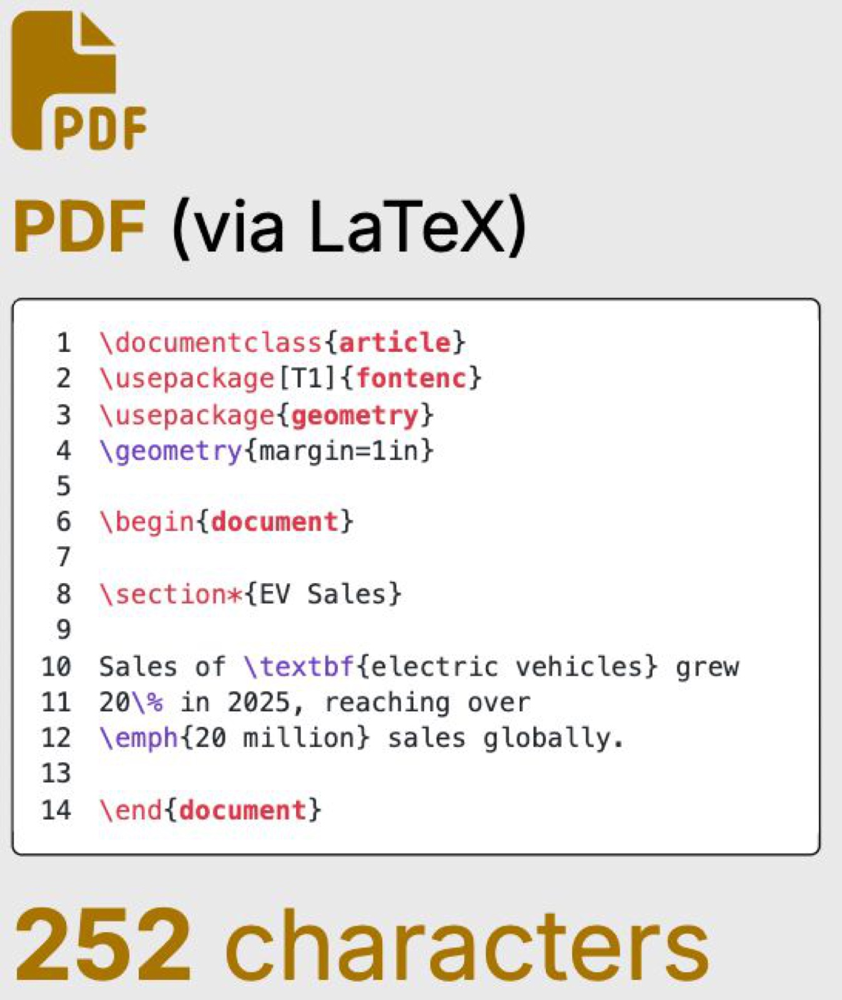
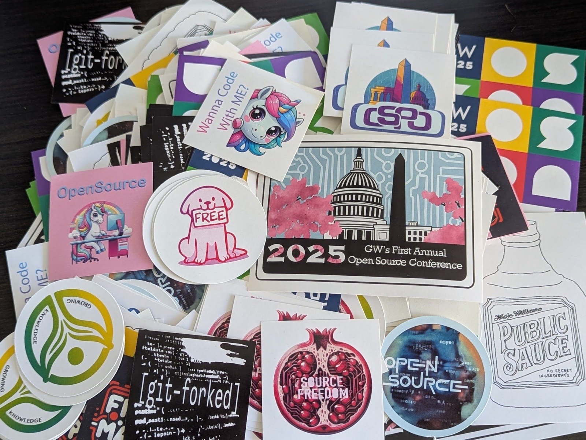
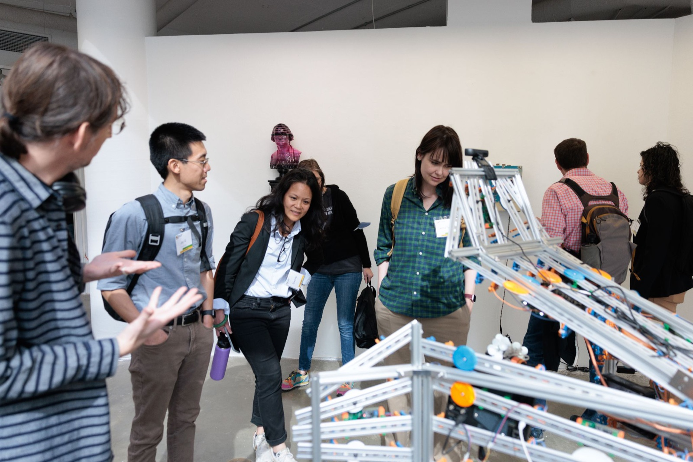

## How the GW OSPO Uses Skill.md and AI {.dark .cover background-color="#00223E"}

GW Open Source Program Office

[David Lippert]{.byline}

::: notes
~30 min talk + ~15 min questions. Pacing: Overview 3 min, Part 1 7 min, Part 2 8 min, Part 3 5 min, Part 4 6 min, close 1 min.
:::

<!-- ============ OVERVIEW (3 slides, ~3 min) ============ -->

## GW Open Source Program Office {.content-slide}

Overview

::: {.split .wide-left}
::: {}
**Based in the Library**, serving all GW students, faculty, staff, and researchers.

**Mission:** foster a culture of open collaboration through open source software, open data, and open access.

[ospo.gwu.edu](https://ospo.gwu.edu/)
:::
::: {}

:::
:::

## What we do {.content-slide}

Overview

::: {.tiles}
::: {.tile}
[Educate]{.tile-label}

- What is open source?
- How do I make research outputs public?
- Can open source help me get a job?
:::
::: {.tile}
[Connect]{.tile-label}

- Open source as the glue to help academia, industry, government, & other orgs work together
- Network: CURIOSS, CHAOSS, OFAI, UN, Nava, Civic Tech DC, CMS, TODO, ...
:::
::: {.tile}
[Support]{.tile-label}

- Consultations
- Workshops
- Grant support
- Initiatives
- Events
:::
:::

## Events {.content-slide}

Overview

::: {.split}
::: {}
- [GW OSCON](https://ospo.gwu.edu/open-source-conference-gw-oscon-2027), March 31 to April 1, 2027
- GW Coders Lunch & Learn
- Hackathons and the Halloween Robot Challenge
- Student ambassadors and awards
:::
::: {}

[2025/2026 GW OSPO Ambassadors]{.caption}
:::
:::

::: notes
Keep this to about 3 minutes total. The rest of the talk is about AI.
:::

<!-- ============ PART 1: DESIGN SKILL (~7 min) ============ -->

## A design skill and a review process {.dark .divider background-color="#00223E"}

Part 1

::: {.lead}
How AI helps us make on-brand materials.
:::

## From first draft to final {.content-slide}

Part 1 · Design skill

::: {.compare}
::: {}

[Original]{.caption}
:::
::: {.arrow}
→
:::
::: {}

[Final]{.caption}
:::
:::

::: notes
Student awards graphic. Walk through what changed: hierarchy, palette, spacing. Original made by hand; final made with the design skill and then reviewed.
:::

## Skill, then review {.content-slide}

Part 1 · Design skill

::: {.tiles}
::: {.tile}
[1 · Generate]{.tile-label}

Our internal OSPO Marketing & Comms team creates a flyer, newsletter, website, or other output.
:::
::: {.tile}
[2 · Review]{.tile-label}

The design skill checks the graphic against the brand and layout principles.
:::
::: {.tile}
[3 · Human decides]{.tile-label}

A person reads the report, fixes priorities, iterates, and approves.
:::
:::

::: notes
Repos: github.com/gw-ospo/gwospo-brand and github.com/gw-ospo/gw-design-review. The newest piece is the gw-presentation skill (github.com/gw-ospo/gw-presentation), which built this deck.
:::

## What the review checks {.content-slide}

Part 1 · Review process

::: {.tiles .cols-4}
::: {.tile .slim}
[Proximity]{.tile-label}

Related things sit together.
:::
::: {.tile .slim}
[Alignment]{.tile-label}

Every element lines up with something.
:::
::: {.tile .slim}
[Repetition]{.tile-label}

One visual system, used consistently.
:::
::: {.tile .slim}
[Contrast]{.tile-label}

The main point is obvious.
:::
:::

::: notes
Plus brand rules: GW palette, accessible color pairings, approved fonts, and the OSCON extended palette. Output is a prioritized list of fixes.
:::

## How a review is written {.content-slide}

Part 1 · Review process

Read<b>One-line read</b> and what the eye sees first, second, third.

Start here<b>What's working.</b> Two or three real strengths, before any criticism.

Must fixBreaks a brand rule or accessibility. Not taste.

Should fixHarder to read than it needs to be.

ConsiderA suggestion. Take it or leave it.

Next<b>If you only do three things:</b> a short checklist.

::: notes
Show the markdown report (top of the real review of the awards flyer, 2026-09-11). Point out that it opens with what is working: the review is written for students and staff who made the piece themselves. Each finding names where the problem is, which rule it relates to, and the exact fix. Ends with "If you only do three things" and the checks that were run (palette audit, contrast). The reviewer does not redesign the work; it tells you what to change and why, then stops.
:::

## Review finding 1: an off-brand blue {.content-slide}

Part 1 · Review of the original

<b>1</b><b>2</b>

A flat blue that isn't in the GW palette runs through the page.

<ul><li>Measured <b>#0096D5</b>, not Potomac <b>#0075C8</b></li><li>White text on it: <b>3.32:1</b>, large text only</li><li>On Potomac: <b>4.80:1</b>, passes at any size</li><li>Fix: swap both areas to Potomac</li></ul>

::: notes
Must fix #1. Highlight 1: stripe accents at the top. Highlight 2: the deadline banner. brand-checks C1 (no off-palette colour). Source: design review of the awards flyer, 2026-09-11.
:::

## Review finding 2: no Gazzetta {.content-slide}

Part 1 · Review of the original

<b>1</b><b>2</b><b>3</b><b>4</b><b>5</b>

Every headline is set in a serif face. Gazzetta appears nowhere.

<ul><li>Five headline moments, one serif face</li><li>Source Serif should stay rare: one word or a pull quote</li><li>Fix: reset all five in Gazzetta</li><li>No Gazzetta? Use Avenir Next Bold, not the serif</li></ul>

::: notes
Must fix #2. brand-checks T2 (Gazzetta carries headlines) and T5 (Source Serif stays rare). Highlights: title, prize amount, the two award headers, the deadline.
:::

## Review finding 3: hierarchy {.content-slide}

Part 1 · Review of the original

<b>1</b><b>2</b><b>3</b>

The loudest shape is the prize amount. The deadline is last.

<ul><li>Reading order: prize banner, photo, title, and only then the deadline</li><li>The hero block is centered; the rest is left-aligned</li><li>Fix: left-align the hero and give the deadline more weight</li><li>Or quiet the cream prize banner</li></ul>

::: notes
Should fix #3 (alignment) and #4 (contrast). Highlight 1: centered hero block. Highlight 2: cream prize banner, the highest-contrast shape. Highlight 3: the deadline banner, the actual call to action. The one job of this piece is to get students to apply by November 1.
:::

## From first draft to final {.content-slide background-color="#EEEEEE"}

Part 1 · Design skill

::: {.compare}
::: {}

[Original]{.caption}
:::
::: {.arrow}
→
:::
::: {}

[Final]{.caption}
:::
:::

::: notes
Back to the before and after, now that we have seen what the review found. Walk through what changed: the on-palette blue, the headline type, the left alignment, and the deadline carrying more weight.
:::

## Inside the design review repo {.content-slide}

Part 1 · The skill

SKILL.md
The instructions Claude follows: how to look at a design and how to write the report.

brand/
<code>DESIGN.md</code> is the rulebook, <code>palette.json</code> the colors, <code>profile.md</code> who the reviews are for.

references/
<code>brand-checks.md</code>, <code>design-principles.md</code>, and <code>report-format.md</code>: what to check and how to write it.

scripts/
<code>contrast.py</code> and <code>palette_audit.py</code> measure; <code>rasterize.py</code> turns PDFs into images.

Lives in <code>.claude/skills/gw-design-review/</code>. A ready-made <code>gw-design-review.zip</code> is included for claude.ai.

::: notes
Repo: github.com/gw-ospo/gw-design-review. The skill follows the open Agent Skills format, so it is portable across tools; the only thing that differs is which folder each tool looks in. Brand rules live in one place (brand/DESIGN.md) so updating the rulebook updates the reviewer. The scripts give real measurements, so colors and contrast are checked, not guessed.
:::

## Using a skill with Claude {.content-slide}

Part 1 · The skill

claude.ai
<ol>
<li>Download <code>gw-design-review.zip</code></li>
<li>Settings, then Capabilities, then Skills</li>
<li>Upload skill (don't unzip)</li>
</ol>

Claude desktop, Cowork, Code
<ol>
<li>Download the repo (Code, then Download ZIP)</li>
<li>Point Claude at the folder</li>
<li>Nothing to install</li>
</ol>

Any other AI tool
<ol>
<li>Attach the four text files</li>
<li>Ask for the report</li>
<li>No setup, no auto contrast checks</li>
</ol>

<b>Then ask:</b> "Review this poster against our brand guidelines. It's a printed 11×17 for the OSCON call for papers."

::: notes
Have three answers ready: what it is and where it will end up, who it is for and what they should do next, and whether it is OSCON or general OSPO (OSCON has three extra accent colors). Claude Code: git clone the repo, cd in, run claude; or symlink the skill into ~/.claude/skills to use it in any folder. Do not upload the GitHub repo zip to claude.ai; use the ready-made gw-design-review.zip. ChatGPT/Codex reads .agents/skills, so copy the folder there. Ask early, not at the end; it will not redesign your work; if it is wrong, say so and ask it to look again.
:::

## Where to find the skills {.content-slide}

Part 1 · The repos

gwospo-brand
Brand assets and the design system for the GW OSPO, including the OSCON palette and patterns.

[github.com/gw-ospo/gwospo-brand](https://github.com/gw-ospo/gwospo-brand)

gw-design-review
The design reviewer. Checks a flyer, poster, deck, or page against the brand and the four principles.

[github.com/gw-ospo/gw-design-review](https://github.com/gw-ospo/gw-design-review)

gw-presentation
Builds GW-branded slides. The newest piece, and it helped build this deck.

[github.com/gw-ospo/gw-presentation](https://github.com/gw-ospo/gw-presentation)

All three skills created by <b>Professor Lorena Barba</b>

::: notes
Photo of Lorena Barba: Lorena Barba, CC BY 3.0, via Wikimedia Commons. The workflow: the brand repo defines the standard, the design review skill checks work against it, and the presentation skill produces on-brand slides to begin with. All three are open source from the gw-ospo GitHub organization.
:::

<!-- ============ PART 2: QUARTO (~8 min) ============ -->

## Quarto and AI {.dark .divider background-color="#00223E"}

Part 2

::: {.lead}
Research from Professor John P. Helveston.
:::

## Quarto disentangles content and format {.content-slide}

Part 2 · Professor John P. Helveston, posit::conf(2026)

::: notes
Live embed of slide 9 from Professor Helveston's posit::conf(2026) talk (jhelvy.github.io/2026-posit-conf-quarto/#/8). Needs internet. Click inside the frame to advance its fragments, then use the arrow keys outside it. Write once in plain text; choose slides, PDF, web page, or Word later.
:::

## Quarto disentangles content and format, continued {.content-slide}

Part 2 · Professor John P. Helveston, posit::conf(2026)

::: notes
Live embed of slide 10 (jhelvy.github.io/2026-posit-conf-quarto/#/9).
:::

## Same content, four formats - output tokens {.content-slide}

Part 2 · Quarto

::: {.formats}
::: {}
[1×]{.mult}
[Quarto]{.mult-label}

:::
::: {}
[1.8×]{.mult}
[PDF (LaTeX)]{.mult-label}

:::
::: {}
[4×]{.mult}
[HTML]{.mult-label}

:::
::: {}
[7.2×]{.mult}
[Word]{.mult-label}

:::
:::

::: notes
Characters needed to express the same sentence: Quarto 125, PDF 252, HTML 377, Word 663. Credit Prof. Helveston's slides.
:::

## Three benefits with AI {.content-slide}

Part 2 · Quarto

::: {.tiles}
::: {.tile}
[Modularity]{.tile-label}

Content and format live apart, so AI can edit one without breaking the other.
:::
::: {.tile}
[Efficiency]{.tile-label}

Plain text is short. Fewer characters means fewer tokens, lower cost, faster edits.
:::
::: {.tile}
[Correctness]{.tile-label}

Small readable files are easy for people to check and for Git to diff.
:::
:::

## This deck is a quarto markdown file {.content-slide}

Part 2 · Quarto

::: {.split}
::: {}
**index.qmd** holds the words. **gw-theme.scss** holds the look.

Change the theme and every slide changes. Change a sentence and the design is untouched.
:::
::: {.tile}
[Source]{.tile-label}

[github.com/gw-ospo/todo-ai-agent-presentation](https://github.com/gw-ospo/todo-ai-agent-presentation)
:::
:::

<!-- ============ PART 3: OTHER AI WORK (~5 min) ============ -->

## Other AI work {.dark .divider background-color="#00223E"}

Part 3

::: {.lead}
Research, policy, and the pop-up AI museum.
:::

## AI research {.content-slide}

Part 3 · Other AI work

::: {.tiles .cols-2}
::: {.tile}
[TAI · Trustworthy AI]{.tile-label}

- Openness as a path to trust
- NSF TRAILS: AI skills and open source literacy
:::
::: {.tile}
[OFAI · Open Forum for AI]{.tile-label}

- CMU, UT Austin, Georgia Tech, Purdue, GW
- Research, prototypes, policy, community, talent
:::
:::

## Open source research game {.content-slide .game-slide}

Part 3 · TAI

drag each logo to proprietary, open source, or I don't know

::: notes
The frame runs the open source research game live (gw-ospo.shinyapps.io/os-research-game). Needs internet; shinyapps.io may take a few seconds to wake up, so open this slide early. Click inside the frame to play; use the arrow keys outside it to move on.
:::

## Open Source, AI, and Art {.content-slide}

Part 3 · Other AI work

<figure class="art-embed">

<figcaption class="caption">good first contributions</figcaption>
</figure>
<figure><figcaption class="caption">digital art student stickers</figcaption></figure>

<figure class="art-main"><figcaption class="caption">open source art show</figcaption></figure>

::: notes
TODO: replace with pop-up AI museum photos and add 2-3 facts (dates, location, what visitors did). The embedded site is gw-ospo.github.io/open-source-workshop (live, needs internet); caption: good first contributions.
:::

<!-- ============ PART 4: ORB + OSPO RADAR (~6 min) ============ -->

## Thank you {.dark .big-idea .rule background-color="#00223E"}

Questions?

::: {.contact}
<a href="https://ospo.gwu.edu/">ospo.gwu.edu</a> · <a href="mailto:ospo@gwu.edu">ospo@gwu.edu</a> · <a href="https://github.com/gw-ospo">github.com/gw-ospo</a>
:::

::: {.gloss}
Let's collaborate on research projects and to provide opportunities for students.
:::

::: notes
About 15 minutes for questions. Backup slides follow: open source discovery and curation (ORB and OSPO Radar).
:::

<!-- ============ BACKUP ============ -->

## Backup {.dark .divider background-color="#00223E"}

Backup slides

::: {.lead}
Open source discovery and curation.
:::

## Open Source Discovery & Curation {.content-slide}

Backup · Discovery

::: {.tiles .cols-2}
::: {.tile .slim .compact}
[ORB · Open Source Repository Browser]{.tile-label}

- Built by the UC OSPO Network
- Maps and classifies open source projects across UC campuses
- Makes projects easier to find for researchers, students, and collaborators
- Raises visibility, recognition, and funding potential

[ORB on GitHub](https://github.com/UC-OSPO-Network/orb-showcase)
:::
::: {.tile .slim .compact}
[OSPO Radar · with Software Heritage]{.tile-label}

- Two-year, Sloan Foundation funded project
- Institutional portal and software assets dashboard for OSPOs
- Builds on CodeMeta metadata and Software Heritage archiving
- Includes an Open Science helpdesk and training

[OSPO-RADAR launch post](https://www.softwareheritage.org/2025/04/02/ospo-radar-project-launch/)
:::
:::

::: notes
ORB: github.com/UC-OSPO-Network/orb-showcase (UC Open Source Repository Browser Showcase). OSPO-RADAR = Open Source Program Office Research Assets Dashboard and Archival Resource. Source: softwareheritage.org/2025/04/02/ospo-radar-project-launch/. Software Heritage is collaborating with CURIOSS and seeking academic OSPOs to join. Add a screenshot of ORB or the Radar dashboard if one is available; the ORB demo site (orb-showcase-seven.vercel.app) returned 404 when checked.
:::
